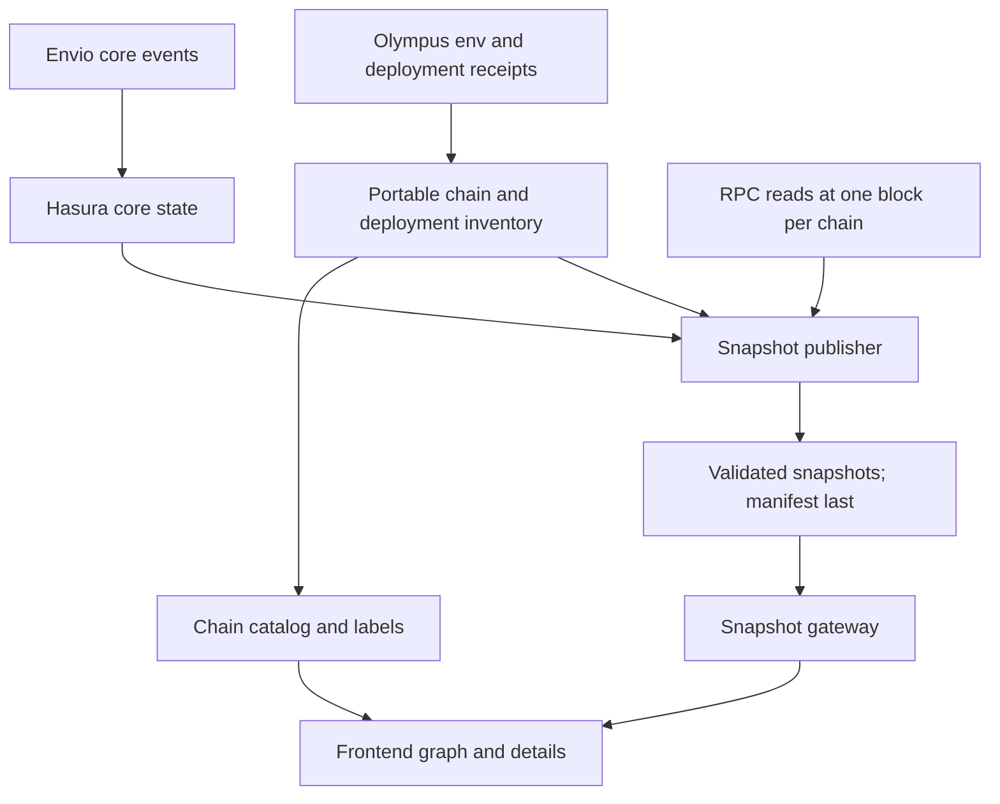
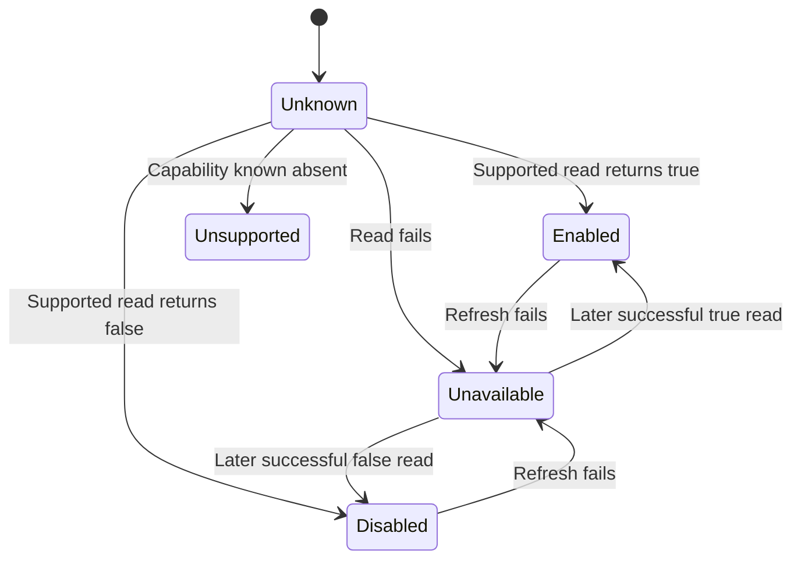
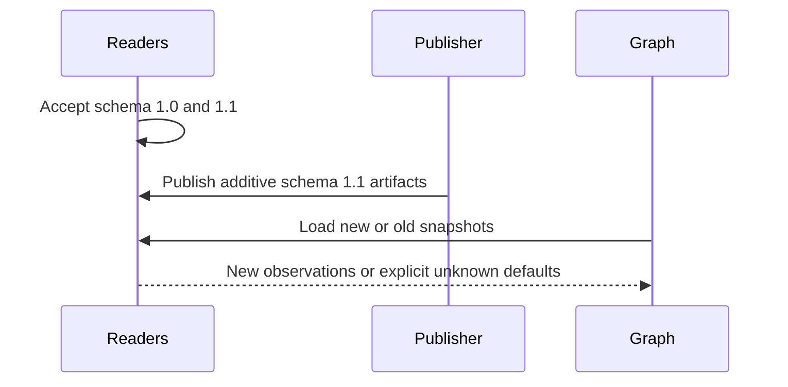

# Chain coverage, enabled state, and authority relationships

## Goal Capsule

- **Objective:** A viewer can find Olympus deployments on every recorded EVM network, see whether a contract is enabled, and trace who controls it.
- **Means:** Extend the existing indexer and snapshot pipeline with a deployment inventory and block-pinned state observations (KTD1–KTD5).
- **Authority:** Olympus deployment records identify addresses; the deployed contract's reads establish current state. Intended setup values and deployment scripts do not establish completed handovers.
- **Execution:** Six local implementation milestones below. This document authorizes no chain transactions or deployment. Publication remains a separate user decision.
- **Stop conditions:** Preserve conflicting source records and resolve their provenance before importing them. Never replace missing observations with assumed owners or enabled values.

---

## Product Contract

### Summary

Add Robinhood Chain, reconcile EVM chain coverage against Olympus V3, and extend the graph beyond Kernel modules and policies. Display operational enablement and distinct ownership, registry administration, and legacy authority relationships.

### Problem Frame

The current graph describes Bophades permissions but omits much of the surrounding control structure. Its `isEnabled` flag records Kernel membership. It does not read `IEnabler.isEnabled()`, and the publisher filters out inactive core contracts. Naming a periphery contract in the indexer's address book does not create a visible graph node.

### Requirements

**Deployment and network coverage**

- R1. Import the thirteen Robinhood deployments and named actors from Olympus V3's `feat-robinhood-chain-deployment` worktree, retaining chain, address, name, type, and deployment provenance.
- R2. Represent all eleven EVM networks under `current` in that worktree's `src/scripts/env.json`, grouped into Production and Testnets. Historical or unavailable networks remain visible with their recorded inventory and availability explanation.
- R3. Exclude Solana and Solana-devnet explicitly from this EVM reconciliation. Treat `last` as previous deployments, and zero addresses as missing records.

**Operational state**

- R4. Show `IEnabler` enabled/disabled state separately from Kernel active/inactive state. Support both legacy `IEnabler` and `IEnablerV2`, including implementations without ERC165.
- R5. Distinguish successful `false` reads from unsupported capabilities, unknown capabilities, and unavailable reads. Preserve observation height/time; a failed refresh must not imply a fresh success.

**Ownership and authority**

- R6. Show actual periphery ownership, using the ABI getter implemented by each deployment. Solmate sources inspected here expose lowercase `owner()`, rather than uppercase `OWNER()`.
- R7. Show OHM's token-scoped administrator in the CCIP TokenAdminRegistry, the registered pool, and that pool's actual owner. Keep these distinct from the registry contract's global owner.
- R8. Show legacy contract-to-Authority references and OlympusAuthority governor, guardian, policy, and vault holders. Include relevant OHM, minter/module, staking, sOHM, and gOHM control links where those contracts exist.
- R9. Separate current control from exposed pending nominations. A nomination or configured desired address must not replace the current holder.

**Graph and data behavior**

- R10. Give one node to each normalized chain/address identity, even when it is a contract, owner, role assignee, and authority holder. Preserve separate, labelled relationships between the same endpoints.
- R11. Imported external or inactive deployments remain visible without invented Kernel membership. Unknown actors are labelled as unknown addresses unless account classification is verified.
- R12. Refresh graph state when a new snapshot arrives, and support the existing snapshot format during rollout. Keep browser access read-only through the gateway.

### Acceptance Examples

- AE1. Selecting Robinhood shows the recorded stack and chain-specific explorer links; an identical address on Ethereum keeps its Ethereum identity and label. Covers R1, R10.
- AE2. A Kernel-active policy whose `isEnabled()` returns false remains visible as Kernel active and Contract disabled. A timeout displays unavailable instead. Covers R4, R5, R11.
- AE3. One multisig holding governor and guardian produces one actor node with two labelled relationships. A new nominee is shown separately. Covers R8–R10.
- AE4. The registry reports administrator A and pool P, while `P.owner()` returns B: the graph displays A's OHM registry administration and B's pool ownership independently. Covers R7.
- AE5. Goerli or Bartio being unavailable does not stop publication for active networks. Their recorded deployments can still be inspected. Covers R2.
- AE6. A refreshed snapshot changes an owner or enabled badge without requiring a chain switch. An older snapshot leaves new state unknown. Covers R5, R12.

### Scope Boundaries

This work displays recorded deployments and observed control. It does not perform ownership transfers, enable/disable contracts, register CCIP pools, execute governance, or infer that a whole bridge is operational from one contract's enablement flag.

New observations describe current snapshots. Full ownership/enablement event history and historical reconstruction are deferred to follow-up work. In particular, pool versions without an exposed pending-owner getter will not gain a speculative pending owner through private-storage decoding.

No new browser RPC polling, general plugin framework, or replacement indexer is needed. Existing role and module-permission views remain available.

---

## Planning Contract

### Source Baseline

Visualizer baseline: dependency commit `f35dfb72d11a8a09a16b803dafd6f3202545dcca` on `feat/robinhood-chain`.

Olympus V3 deployment source: clean `feat-robinhood-chain-deployment` at `e61def7b8a12628f32a84406a8e4bc4c5594cb5a`. Its `src/scripts/env.json` matches thirteen successful creation receipts in `broadcast/L2Deploy.s.sol/4663/run-1792574052101.json`. The broadcast records deployment commit `736545186f`. Its artifact timestamp is not a block timestamp.

The CCIP sibling worktree still has zero Robinhood deployment placeholders. The primary Olympus checkout lacks Robinhood and has other deployment differences. Do not merge their environment files wholesale. The Robinhood branch's `documentation/bridge/ccip/ROBINHOOD_PENDING.md` is stale relative to its successful receipts.

The source inspection establishes addresses and interface semantics. Current owners, administrators, enabled values, RPC reachability, and indexing success have not been live-verified in this planning pass.

### Network Inventory

| Group | Olympus key | Chain ID | Current visualizer | Planned treatment |
| --- | --- | ---: | --- | --- |
| Production | mainnet | 1 | Present | Retain |
| Production | optimism | 10 | Present | Retain |
| Production | arbitrum | 42161 | Present | Retain; configure state RPC explicitly |
| Production | base | 8453 | Present | Retain |
| Production | berachain | 80094 | Present | Retain |
| Production | robinhood | 4663 | Missing | Add deployment inventory and indexing |
| Testnets | sepolia | 11155111 | Present | Retain |
| Testnets | arbitrum-sepolia | 421614 | Missing | Add inventory and indexing |
| Testnets | base-sepolia | 84532 | Missing | Add inventory and indexing |
| Testnets | berachain-bartio | 80084 | Missing | Historical candidate; inventory without mandatory live polling |
| Testnets | goerli | 5 | Missing | Historical candidate; inventory without mandatory live polling |

Availability is separate from the production/testnet grouping. Establish it during implementation rather than inventing working endpoints for historical chains. Robinhood Testnet is not an `env.json` entry and is outside this reconciliation.

### Key Technical Decisions

- KTD1. **Use a portable deployment inventory.** Add `packages/protocol-config/protocol-deployments.json` with chain-scoped entries and provenance. Preserve existing historical aliases in `ContractNames.ts`; new labels should resolve through the inventory without copying addresses into several competing registries. Update the metadata generator, which currently parses literal TypeScript address entries, to understand that source. Do not import desired configuration values as observed relationships. Governs R1–R3, R10–R11.
- KTD2. **Keep Envio for the existing event-derived core; enrich snapshots with current reads.** The publisher is the owner of new operational observations. This avoids a new event subscription/backfill for every ownership dialect and catches getters whose setters emit no event. Existing indexed history remains unchanged. A versioned capability list and small concrete readers are sufficient; a generic adapter framework is unnecessary. Governs R4–R9.
- KTD3. **Pin reads per chain and disclose the two clocks.** Select one explicit RPC block and hash for a publication's state reads. Carry its timestamp and per-field read outcome separately from Envio indexing progress and `generatedAt`. Do not claim GraphQL rows and RPC reads form an atomic historical snapshot. If the block hash changes during reads, mark that enrichment unavailable; do not silently retry failed historical reads at latest. Use ordinary JSON-RPC batching first; Multicall3 is optional only after its deployment is verified. Governs R5. See [Viem block-pinned reads](https://viem.sh/docs/contract/multicall).
- KTD4. **Make the snapshot extension additive.** Keep the existing `data.contracts`, roles, assignments, and their meanings. Add optional `additionalContracts`, `contractStates`, `relationships`, and per-chain observation metadata in schema 1.1.0. `additionalContracts` supplies inventory-backed and inactive nodes absent from the existing active-core array. Readers accept 1.0.0 and 1.1.0 before the publisher emits 1.1.0; older snapshots default new fields to empty/unknown. Preserve `/v1` transport routes and manifest-last publication. Shared types/schemas in `packages/snapshot-artifacts` own the extension; remove or align the duplicate publisher schema rather than letting them disagree. Governs R4–R5, R11–R12.
- KTD5. **Keep the chain catalog separate from readiness membership.** Add environment and availability to `protocol-chains.json`. Only networks enabled for indexed publication are required by publisher/monitor readiness. Historical networks expose inventory and a clear live-data limitation without fetching a nonexistent snapshot. Default publisher selection must not expand to every catalog entry. Governs R2, R11–R12.
- KTD6. **Prefer ABI/source-backed capabilities over ERC165-only inference.** Read `isEnabled()` on known implementations even if they lack `supportsInterface()`. Use ERC165/verified ABI metadata for discovered contracts where available; a generic revert proves neither unsupported nor disabled. V2 transition metadata is supplementary. MINTR `active()`, policy `isActive()`, and `IEnabler.isEnabled()` remain independent concepts. Governs R4–R5.
- KTD7. **Model typed relationships and references.** Current control edges run controller → controlled target; authority-reference and registered-pool links are labelled references with their own direction. Include relationship kind, endpoints, registry/token scope, source getter, and observation metadata in identity/details. Do not infer pool ownership from registry administration or reuse role names as ownership types. Governs R6–R10.

### Data Extension

The implementation should use the following boundaries; exact helper names can follow existing conventions.

- **Additional contract:** chain/address identity, display name, category, optional known core type/version, and inventory provenance. Include only nodes absent from the legacy active-core array; merge by identity in the UI.
- **Contract state:** identity, Kernel membership when known, IEnabler capability/read outcome and boolean when successfully read, and optional supported V2 transition data. Known unsupported and unobserved/read-failed are different outcomes.
- **Relationship:** typed endpoints and scope, current or pending status, and source getter. Failed reads produce unavailable observation metadata, not fabricated current edges. Zero/unset holders produce an explicit unset state and no zero-address actor.
- **Observation:** state block number/hash/timestamp and read outcomes. A previous successful value is not reused as current after failure; any retained last-known display must retain its old observation label.

### Technical Design

### Assumptions and Deferred Checks

- Latest observed state at publication time is sufficient; the user has not requested historical reconstruction of the new relationships.
- Historical network availability and provider support will be checked in U2. Their inventory coverage does not depend on proving live access.
- Obtain the actual creation-block timestamps for the new indexer anchors in U1/U2. Do not copy the broadcast's millisecond timestamp or Solidity `block.number` into RPC receipt-height fields.
- The DAO MS example is a desired observation to verify, not a hardcoded expected owner/admin. Use each chain's actual registry/pool reads in U6.

---

## Implementation Units

### U1. Import Robinhood deployment records and index the core

**Goal:** Robinhood is selectable and its core is indexed using the recorded deployment anchors. **Requirements:** R1, R3, R10. **Dependencies:** none.

**Files:** `packages/protocol-config/protocol-chains.json`; new `packages/protocol-config/protocol-deployments.json`; `apps/indexer/config.yaml`; `apps/indexer/src/constants.ts`; `apps/indexer/src/ContractNames.ts`; `apps/indexer/src/events/rpc.ts`; `scripts/generate-indexer-contract-metadata.mjs`; `apps/indexer/src/generated/contract-metadata.json`; `.env.compose.sample`; `apps/indexer/.env.sample`; `docker-compose.yml`; `docs/local-stack.md`; `docs/railway-self-hosting.md`; `tests/config.test.mjs`.

**Approach:** Import the Appendix's thirteen deployments plus named actors/infrastructure with KTD1 provenance. Obtain block timestamps for Kernel, ROLES, and RolesAdmin from their receipt heights. Extend chain constants, event addresses/start blocks, state RPC settings, and generated source metadata together. Use verified local ABI/source artifacts if explorer metadata is unavailable. Do not invent staking or LayerZero contracts for Robinhood.

Robinhood has [official chain configuration](https://docs.robinhood.com/chain/connecting/) and [Envio HyperSync support](https://docs.envio.dev/blog/index-robinhood-chain-data). HyperSync supplies event history; state getters still need an RPC that implements `eth_call`. The public RPC is a local starting point, not a production provider decision.

**Test scenarios:**

1. Match all thirteen imported addresses to successful receipt provenance; reject zero addresses and duplicate chain/address entries.
2. Confirm the three trigger addresses/start blocks agree across inventory, constants, and indexer configuration.
3. Resolve a Robinhood address also used on Ethereum without cross-chain label leakage (AE1).

**Verification:** A local Robinhood replay produces correctly named Kernel/modules/policies and a real snapshot. Receipt/code checks establish deployed addresses; sample mode alone does not establish success. External-node completeness lands in U3.

### U2. Reconcile EVM networks and group the chain selector

**Goal:** Every source EVM network is represented without historical networks blocking current publication. **Requirements:** R2–R3, R11–R12. **Dependencies:** U1.

**Files:** shared chain/deployment inventory; `apps/frontend/src/lib/constants.ts`; `apps/frontend/src/components/chain-selector/index.tsx`; `apps/frontend/src/components/contract-visualizer/index.tsx`; indexer config/constants/RPC metadata; `apps/snapshot-publisher/src/chains.ts`; `apps/snapshot-publisher/src/publish.ts`; `apps/snapshot-monitor/src/monitor.ts`; `apps/snapshot-gateway/src/server.ts`; related Dockerfile config copies; env samples/docs from U1; `tests/config.test.mjs`; `apps/snapshot-publisher/test/publish.test.ts`; `apps/snapshot-monitor/test/monitor.test.ts`; `apps/snapshot-gateway/test/server.test.ts`.

**Approach:** Reconcile the Network Inventory table with source `current` keys. Add Arbitrum Sepolia and Base Sepolia deployment anchors. Provide Production/Testnets selector groups and a read-only inventory view for unavailable networks. Apply KTD5 consistently to publisher defaults, readiness, monitor expectations, gateway chain listings, and sample generation. Do not make an unavailable catalog entry trigger a failing snapshot request.

**Test scenarios:**

1. Reconciliation covers eleven EVM keys and explicitly excludes both Solana keys.
2. Goerli/Bartio inventory remains reachable while active-chain publication and monitoring succeed (AE5).
3. Arbitrum/Base Sepolia seed anchors agree with successful creation receipts; zero multisigs stay unset.
4. Mainnet remains the default and existing selected chain IDs remain valid.

**Verification:** Review the coverage table against the imported source revision. Verify replay and snapshots on each newly active network; record historical/unavailable status explicitly for the others.

### U3. Extend snapshots with observed state and additional nodes

**Goal:** The existing gateway can carry source-backed external nodes and block-pinned observations without breaking older clients. **Requirements:** R5, R9–R12. **Dependencies:** U1, U2.

**Files:** `packages/snapshot-artifacts/src/index.ts` and `test/index.test.ts`; publisher `src/types.ts`, `src/schema.ts`, `src/snapshot.ts`, `src/protocol-query.ts`, `src/publish.ts`, `src/sample-data.ts`, `package.json`; new publisher `src/contract-state.ts` and `test/contract-state.test.ts`; publisher `test/snapshot.test.ts`, `test/publish.test.ts`; gateway `src/server.ts`, `openapi.json`, `test/server.test.ts`; frontend `src/services/contracts.ts`; publisher Dockerfile/config copies and RPC env documentation.

**Approach:** Implement KTD2–KTD5. Reuse the existing Viem dependency/version for publisher reads. Keep the legacy active-core query/output intact and obtain unfiltered known-core rows for the extension so inactive deployments are not lost. Merge those rows with the explicit inventory, and ensure imported external nodes do not depend on Kernel events. Sample mode remains deterministic and never performs live RPC reads.

Export shared observation and relationship types from the artifact package. Add reader compatibility before changing the emitted schema constant. Keep gateway readiness and indexer readiness distinct from optional getter availability; return visible field-level unknown/unavailable outcomes for partial reads.

**Test scenarios:**

1. Old 1.0 snapshots load with empty additions and unknown state; 1.1 round-trips through publisher, gateway, and frontend service (AE6).
2. A chain containing only additional nodes renders meaningful data rather than the current empty-core message.
3. An inactive known policy is included in the extension while the legacy core array keeps its meaning.
4. All RPC calls use the selected per-chain block; a changed hash or failed getter never becomes a fresh current value.
5. Invalid/unsupported major versions fail clearly; partially unreadable observations do not corrupt manifest-last publication.

**Verification:** Schema/API fixtures and publication tests pass with mixed old/new artifacts. All thirteen Robinhood deployments are representable, including those outside the core index.

### U4. Display IEnabler state independently of Kernel membership

**Goal:** The graph correctly identifies enabled, disabled, and unreadable contracts. **Requirements:** R4–R5, R11–R12. **Dependencies:** U3.

**Files:** deployment capability inventory; publisher `src/contract-state.ts`, `test/contract-state.test.ts`; frontend `src/services/contracts.ts`, `src/components/contract-visualizer/index.tsx`, `package.json`; new `apps/frontend/src/components/contract-visualizer/graph.ts` and `graph.test.ts`, wired into the existing build/test workflow; publisher sample fixtures/tests.

**Approach:** Implement KTD6 and AE2. Show separate Kernel active/inactive and Contract enabled/disabled labels; unknown, unsupported, and unavailable must be legible without relying on color. Support V2 transition metadata when exposed. Rebuild snapshot-derived graph data on refetch while retaining surviving selections and node positions. Do not label a disabled configuration policy as a disabled CCIP bridge.

**Test scenarios:**

1. A Kernel-active contract with `isEnabled() == false` shows both facts (AE2).
2. An IEnabler implementation without ERC165 is read through its known ABI; a non-IEnabler remains unsupported.
3. Timeout, revert, missing ABI, and old snapshot have distinct truthful outcomes rather than false enabled/disabled badges.
4. A new snapshot changes the badge in an already-open graph (AE6).

**Verification:** Reader fixtures exercise true/false/failure cases. Inspect browser rendering against deterministic snapshots and one read-only production observation at a recorded block.

### U5. Visualize Solmate ownership and legacy Olympus authority

**Goal:** Owners and authority holders connect to their actual controlled contracts. **Requirements:** R6, R8–R12. **Dependencies:** U3, U4.

**Files:** capability inventory; `apps/snapshot-publisher/src/contract-state.ts`, `src/sample-data.ts`, `test/contract-state.test.ts`; frontend `src/components/contract-visualizer/graph.ts`, `graph.test.ts`, `index.tsx`; shared relationship schemas/tests; relevant docs. Publisher and frontend paths in this unit are relative to their respective app directories.

**Approach:** Add concrete readers for source-backed ownership dialects and legacy references. Follow each consumer's actual `authority()` address, then read that Authority's governor/guardian/policy/vault. Do not assume all legacy contracts share the Authority named in `env.json`. Distinguish the Bophades OlympusMinter module from legacy staking/minter control. Use the actual legacy getters for sOHM staking and gOHM minting authorization rather than labelling all references as owners.

Apply KTD7 and canonical chain/address identity across contracts and role assignees. Edge identity includes kind and scope; provide labels/legend and address details for external nodes. Exposed pending nominees are dashed and excluded from current-control summaries. OlympusAuthority's `new*` fields remain populated after pull: a nonzero value equal to the current holder is not a pending handover. Omit its self-referential authority edge from the graph.

**Test scenarios:**

1. One multisig is owner and role assignee without duplicate nodes; governor and guardian edges both survive (AE3).
2. An exposed pending nominee differs from the current holder; a completed OlympusAuthority pull does not remain pending.
3. OHM or staking references a different Authority from the environment label, and the graph follows the observed address.
4. Zero owner is unset; an unknown actor is not automatically labelled EOA; external-only graphs remain navigable.
5. A subsequent snapshot replaces ownership edges rather than appending stale control (AE6).

**Verification:** Compare representative periphery, OHM, Authority, and staking paths with read-only getter results at recorded blocks. Confirm every edge states the kind of authority it represents.

### U6. Visualize token-scoped CCIP administration and pool ownership

**Goal:** The graph distinguishes OHM registry administration, pool registration, and pool ownership on each deployed EVM chain. **Requirements:** R7, R9–R12. **Dependencies:** U3, U5.

**Files:** CCIP entries in deployment inventory; publisher reader/fixtures/tests; shared relationship schemas/tests; frontend graph model/details/tests; `apps/snapshot-publisher/test/snapshot.test.ts`; integration documentation.

**Approach:** Read the configured registry's `getTokenConfig(OHM)` and `getPool(OHM)` at the observation block. Preserve current administrator and exposed pending administrator separately. Resolve the registered pool dynamically and read its `owner()`; if it differs from the recorded pool, show the registry-selected pool and the discrepancy. Registry global ownership is a separate typed edge. Never infer that DAO MS holds both roles from its name or deployment setup. See [Chainlink's TokenAdminRegistry reference](https://docs.chain.link/ccip/v1/evm/api-reference/v1.6.0/token-admin-registry).

The local Olympus `ICCIPTokenAdminRegistry` struct contains administrator, pending administrator, and token pool; `getPool(OHM)` also exposes the registered pool. Use this verified three-address ABI. Some CCIP pool versions expose no pending-owner getter; show current ownership and mark pending-owner visibility unsupported rather than guessing private storage. Burn/mint policy pools combine Kernel membership, IEnabler state, and Chainlink ownership; keep all three on the same policy node.

**Test scenarios:**

1. Registry administrator A and pool owner B produce distinct labelled edges and token/registry scope (AE4).
2. A pending administrator is visible but not counted as current; zero/zero registration is shown as unregistered.
3. Zero pool, stale recorded pool, failing pool getter, and ownerless policy pool do not acquire fabricated owner edges.
4. The same multisig is admin, pool owner, and governor without identity or edge collisions.
5. Refreshing the registry-selected pool removes stale registration links while preserving unrelated role edges.

**Verification:** Read current registry/pool state on every configured EVM CCIP deployment. Verify the Mainnet DAO MS example against actual state and record mismatches. Run full local end-to-end validation before any publication decision.

---

## Verification Contract

The plan itself requires no application builds or RPC execution. During implementation, use existing tests for configuration, publisher, gateway, monitor, and shared artifacts; add focused reader and pure graph-model tests for the new behavior. Do not add a separate test framework just for these milestones.

Follow the root `AGENTS.md` validation sequence in order, stopping at the first failure: runtime-version check, frozen install, lint, build, sample snapshots, then the indexer, frontend, gateway, and publisher Docker builds. Relevant Envio config changes also require code generation and handler type checking. Run monitor tests and its image build when those files change.

Sample output proves serialization/UI cases, not real chain coverage. New active chains require actual replay/snapshot evidence; status and ownership require block-pinned read-only comparisons. Preserve deployment provenance and observation evidence separately. Reader-first schema rollout and manifest-last publication must pass integration tests.

---

## Definition of Done

- [ ] U1: Robinhood anchors, labels, and deployment inventory match receipts; core indexing is demonstrated.
- [ ] U2: All eleven source EVM chains are represented, grouped, and assigned truthful availability without blocking active publication.
- [ ] U3: Additional nodes and observations round-trip through compatible snapshots and the gateway.
- [ ] U4: Enabled state is independent of Kernel membership, and refresh/failure cases render correctly.
- [ ] U5: Ownership and legacy authority paths have correct identities, labels, and current/pending semantics.
- [ ] U6: OHM registry administration and pool ownership are independently observed and displayed.
- [ ] Existing role/module views still work; meaningful checks pass; abandoned implementation attempts are removed.
- [ ] No transaction, push, PR, or deployment is implied by local implementation completion.

---

## Appendix

### Robinhood Import Inventory

Source: Olympus V3 `src/scripts/env.json`, corroborated by the successful creation receipts named in Source Baseline. All addresses are chain 4663 identities.

| Display name | Address | Creation block |
| --- | --- | ---: |
| OlympusAuthority | `0xca6cd4f0a0033f8c20cf68d6df277e7001a386f9` | 94168343 |
| OHM | `0x9c859dc91db65bd7375660341231227336daa134` | 94168423 |
| Kernel | `0x02331a4c97a4841084df54d7c0ec04dd3f1a9f1c` | 94168504 |
| MINTR / OlympusMinter | `0xd98b5b2e4d5d6cd554115de19efb7a9084beddd1` | 94168555 |
| ROLES / OlympusRoles | `0xcb4e21eb404d80f3e1db781aad9ad6a1217fbbf2` | 94168602 |
| TRSRY / OlympusTreasury | `0x20a3d8510f2e1176e8db4cea9883a8287a9029db` | 94168648 |
| RolesAdmin | `0xebde552d851dd6dfd3d360c596d3f4af6e5f9678` | 94168691 |
| Emergency | `0xf35193da8c10e44af10853ba5a3a1a6f7529e39a` | 94168742 |
| TreasuryCustodian | `0xb4f620c39f3ba4a1e7ad264fed6239b0c618db50` | 94168987 |
| CCIPBurnMintTokenPool | `0x5824850d8a6e46a473445a5af214c7ebd46c5ecb` | 94169097 |
| CCIPCrossChainBridge | `0x5261fba7b50aa22b19b9edf939b771d109de991f` | 94169198 |
| CCIPTokenPoolConfig | `0x6d94b3745b0ecf908b3b467907b947b43fba5f15` | 94169625 |
| CCIPTokenPoolConfigTimelock | `0x9f08c2603e919a46d6d98289c9ada5250b310558` | 94169693 |

Named actors and infrastructure: DAO MS `0x317e0f5ef883db95f8ffb5b995b8457903873608`; Emergency MS `0xa8a6ff2606b24f61afa986381d8991dfcccd2dd55`; TokenAdminRegistry `0x1912c3cfafe8a76a32a92861d815ac2837f237ca`; Router `0x06fc836cf9839b1cd891c440a0a45242da6ae1c9`; RMN `0xe8464c353210cc398a45db2454fbc5bcd25fff20`.

### Additional Source Evidence

- Olympus V3 `src/periphery/interfaces/IEnabler.sol`, `src/bases/interfaces/IEnablerV2.sol`, `src/policies/utils/PolicyEnabler.sol`, `src/periphery/PeripheryEnabler.sol`, and `src/bases/EnablerV2.sol`: state and capability semantics. Verified ERC165 IDs are `0xe9fa834a` for IEnabler and `0xb7452dd5` for IEnablerV2; CoolerComposites and CoolerV2Migrator need the known-getter path.
- OlympusDAO `olympus-contracts`, `main` at `bb467babad0e0cfcefb2c5097a6d9476115806d4`: `contracts/Staking.sol`, `contracts/types/OlympusAccessControlled.sol`, `contracts/governance/gOHM.sol`, and `contracts/sOlympusERC20.sol`. The relevant legacy getters are `authority()`, `approved()` for gOHM mint/burn authority, and `stakingContract()` for sOHM rebase authority.
- Olympus V3 `src/external/OlympusAuthority.sol`: governor/guardian/policy/vault reads and persistent `new*` nomination fields.
- Olympus V3 `src/external/bridge/ICCIPTokenAdminRegistry.sol`, `ICCIPTokenPoolAdmin.sol`, `ICCIPLockReleaseTokenPool.sol`: token-scoped admin, pool getters, and ownership dialects.
- Visualizer `apps/indexer/src/events/kernel.ts`, `events/seeding.ts`, and `apps/snapshot-publisher/src/protocol-query.ts`: Kernel-derived state and active-only legacy output.
- Visualizer `apps/frontend/src/components/contract-visualizer/index.tsx`: core-only node discovery, current badge semantics, source/target edge IDs, and graph initialization behavior to extend.
- Visualizer `packages/snapshot-artifacts/src/index.ts` and gateway `activeManifestIssues`: current exact schema-version checks and publication boundary.
