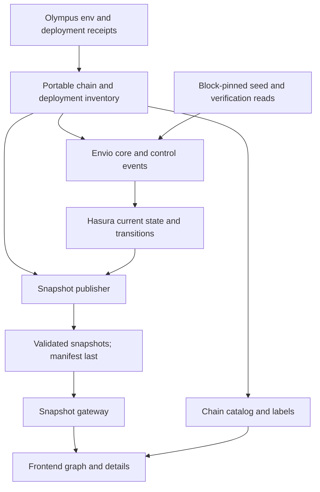
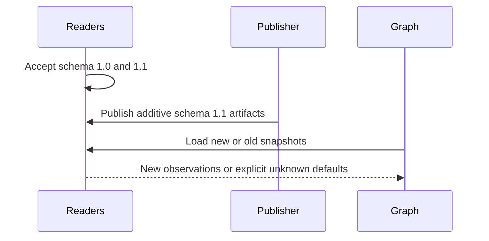

# Chain coverage, enabled state, and authority relationships

## Goal Capsule

- **Objective:** A viewer can find Olympus deployments on every recorded EVM network, see whether a contract is enabled, and trace who controls it.
- **Means:** Extend Envio event indexing and the snapshot pipeline with a deployment inventory, current state, and transition records (KTD1–KTD5).
- **Authority:** Deployment records identify addresses. Verified contract events establish state changes. Block-pinned getter reads establish initial state and verify replay results. Deployment intentions do not establish completed handovers.
- **Execution:** Eight local implementation milestones below. U7 adds shareable navigation; U8 follows with a Mainnet graph readability assessment and improvements. This document authorizes no chain transactions or deployment. Publication remains a separate user decision.
- **Milestone commits:** Validate each milestone. Run the privacy gate before its separate local commit. Commit before the next milestone, with the U-ID in the message. Keep unrelated work outside each commit.
- **Stop conditions:** Preserve conflicting source records and resolve their provenance before importing them. Never replace missing observations with assumed owners or enabled values.

---

## Product Contract

### Summary

Add Robinhood Chain and newly deployed contracts on existing chains. Reconcile EVM chain coverage against Olympus V3, and extend the graph beyond Kernel modules and policies. Display operational enablement and distinct ownership, registry administration, and legacy authority relationships.

### Problem Frame

The current graph describes Bophades permissions but omits much of the surrounding control structure. Its `isEnabled` flag records Kernel membership. It does not read `IEnabler.isEnabled()`, and the publisher filters out inactive core contracts. Naming a periphery contract in the indexer's address book does not create a visible graph node.

### Requirements

**Deployment and network coverage**

- R1. Import the thirteen Robinhood deployments and named actors from Olympus V3's `feat-robinhood-chain-deployment` worktree, retaining chain, address, name, type, and deployment provenance.
  Reconcile newly deployed contracts on existing visualizer chains in the same milestone. Add missing indexing coverage and metadata, with deployment provenance for each chain.
- R2. Represent all eleven EVM networks under `current` in that worktree's `src/scripts/env.json`, grouped into Production and Testnets. Historical or unavailable networks remain visible with their recorded inventory and availability explanation.
- R3. Exclude Solana and Solana-devnet explicitly from this EVM reconciliation. Treat `last` as previous deployments, and zero addresses as missing records.

**Operational state**

- R4. Show `IEnabler` enabled/disabled state separately from Kernel active/inactive state. Unknown state leaves the existing display unchanged, with no enabled-state badge. Support both legacy `IEnabler` and `IEnablerV2`, including implementations without ERC165.
- R5. Track enablement and ownership changes through verified contract events in Envio. Preserve transition provenance and indexing progress. Distinguish disabled state, unsupported capabilities, unknown initial state, and unavailable reads. Getter reads seed and verify state. A failed verification read does not erase established indexed state or imply a fresh success.

**Ownership and authority**

- R6. Show actual periphery ownership from indexed ownership events. Use each deployment’s getter to seed and verify that state. Solmate sources inspected here expose lowercase `owner()`, rather than uppercase `OWNER()`.
- R7. Show OHM's token-scoped administrator in the CCIP TokenAdminRegistry, the registered pool, and that pool's actual owner. Keep these distinct from the registry contract's global owner.
- R8. Show legacy contract-to-Authority references and OlympusAuthority governor, guardian, policy, and vault holders. Include relevant OHM, minter/module, staking, sOHM, and gOHM control links where those contracts exist.
- R9. Separate current control from exposed pending nominations. A nomination or configured desired address must not replace the current holder.

**Graph and data behavior**

- R10. Give one node to each normalized chain/address identity, even when it is a contract, owner, role assignee, and authority holder. Preserve separate, labelled relationships between the same endpoints.
- R11. Imported external or inactive deployments remain visible without invented Kernel membership. Unknown actors are labelled as unknown addresses unless account classification is verified.
- R12. Refresh graph state when a new snapshot arrives, and support the existing snapshot format during rollout. Keep browser access read-only through the gateway.
- R13. Show source-backed contract references as well as control: ConfigTimelock → configured policy, CCIPTokenPoolConfig → configured pool, and analogous verified links. Label references independently from ownership, and retain both when their endpoints coincide.
- R14. Keep the selected chain and graph node (role, contract, or address actor) in a shareable URL. Opening or reloading that URL restores the same chain, selection, focused graph, and details. Browser Back/Forward restores prior navigation.
- R15. Make dense networks such as Mainnet understandable at an architectural level, with a clear route from an overview to individual contracts and their relationships. Grouping and filtering must preserve access to every node, relationship kind, status, and provenance without duplicating shared actors.

### Acceptance Examples

- AE1. Selecting Robinhood shows the recorded stack and chain-specific explorer links; an identical address on Ethereum keeps its Ethereum identity and label. Covers R1, R10.
- AE2. A Kernel-active policy emits `Disabled()` and remains visible as Kernel active and Contract disabled. A failed initial read leaves unestablished state unknown. A later verification timeout preserves established indexed state and shows verification unavailable. Covers R4, R5, R11.
- AE3. One multisig holding governor and guardian produces one actor node with two labelled relationships. A new nominee is shown separately. Covers R8–R10.
- AE4. The registry reports administrator A and pool P, while `P.owner()` returns B: the graph displays A's OHM registry administration and B's pool ownership independently. Covers R7.
- AE5. Goerli or Bartio being unavailable does not stop publication for active networks. Their recorded deployments can still be inspected. Covers R2.
- AE6. A refreshed snapshot changes an owner or enabled badge without requiring a chain switch. An older snapshot leaves new state unknown. Covers R5, R12.
- AE7. A new contract on an existing chain appears with its correct name after replay of the relevant deployment events. Existing deployments retain their identities and history. Covers R1, R10–R11.
- AE8. Ownership and enablement events update current entities and transition records. Duplicate replay produces no duplicate changes. Reorg rollback restores the canonical state and removes orphaned transitions. Covers R5, R9, R12.
- AE9. Selecting Robinhood and a role updates the URL. Opening it in another tab restores that chain and role after data loads. Contract and actor links work the same way, including disabled and uninstalled contracts. Covers R14.
- AE10. A viewer can locate the Cooler and CCIP subsystems from Mainnet's overview, inspect their contracts and control relationships, and return to the overview. A direct contract URL reveals its group and details. Shared owners retain one address identity. Covers R10, R14–R15.

### Scope Boundaries

This work displays recorded deployments and observed control. It does not perform ownership transfers, enable/disable contracts, register CCIP pools, execute governance, or infer that a whole bridge is operational from one contract's enablement flag.

The indexer stores ownership and enablement transitions and derives current state for snapshots. A separate history browser and arbitrary historical graph queries remain outside this plan. Pool versions can expose pending ownership through transfer-request events even without a pending-owner getter. If neither events nor getters establish a field, show that coverage limitation. Do not decode private storage speculatively.

No new browser RPC polling, general plugin framework, or replacement indexer is needed. Existing role and module-permission views remain available.

---

## Planning Contract

### Source Baseline

Visualizer baseline: dependency commit `62462148b3c613b8fd9809e9751a1dec78fdc3ee` on `feat/robinhood-chain`. This includes Tailwind 4, React 19, TypeScript 7, and the metadata generator's TypeScript 6 compatibility API.

Olympus V3 deployment source: clean `feat-robinhood-chain-deployment` at `e61def7b8a12628f32a84406a8e4bc4c5594cb5a`. Its `src/scripts/env.json` matches thirteen successful creation receipts in `broadcast/L2Deploy.s.sol/4663/run-1792574052101.json`. The broadcast records deployment commit `736545186f`. Its artifact timestamp is not a block timestamp.

The CCIP sibling worktree still has zero Robinhood deployment placeholders. The primary Olympus checkout lacks Robinhood and has other deployment differences. Do not merge their environment files wholesale. The Robinhood branch's `documentation/bridge/ccip/ROBINHOOD_PENDING.md` is stale relative to its successful receipts.

U1 must compare deployment records across the relevant Olympus V3 worktrees for existing visualizer chains. Record the selected source revision per chain. Resolve conflicting records from deployment receipts and source evidence before import. A newer branch revision alone does not establish the authoritative deployment record.

The source inspection establishes addresses and interface semantics. Current owners, administrators, enabled values, RPC reachability, and indexing success have not been live-verified in this planning pass.

### Network Inventory

| Group | Olympus key | Chain ID | Current visualizer | Planned treatment |
| --- | --- | ---: | --- | --- |
| Production | mainnet | 1 | Present | Retain |
| Production | optimism | 10 | Present | Retain |
| Production | arbitrum | 42161 | Present | Retain; configure state RPC explicitly |
| Production | base | 8453 | Present | Retain |
| Production | berachain | 80094 | Present | Retain |
| Production | robinhood | 4663 | Missing | Add deployment inventory and indexing |
| Testnets | sepolia | 11155111 | Present | Retain |
| Testnets | arbitrum-sepolia | 421614 | Missing | Add inventory and indexing |
| Testnets | base-sepolia | 84532 | Missing | Add inventory and indexing |
| Testnets | berachain-bartio | 80084 | Missing | Historical candidate; inventory without mandatory live polling |
| Testnets | goerli | 5 | Missing | Historical candidate; inventory without mandatory live polling |

Availability is separate from the production/testnet grouping. Establish it during implementation rather than inventing working endpoints for historical chains. Robinhood Testnet is not an `env.json` entry and is outside this reconciliation.

### Key Technical Decisions

- KTD1. **Keep contract configuration small.** Use the existing `ContractNames.ts` address book for core modules, policies, and historical labels. Add `packages/protocol-config/other-contracts.json` only for additional contracts needed by the requested enablement and ownership views. Entries contain chain, address, name, and a verified start block when available; do not mirror every address in `env.json`. Record source revisions and receipt evidence once in `docs/deployment-coverage.md`. The existing metadata generator continues to read core labels. Do not import desired configuration values as observed relationships. This replaces the broad deployment inventory after the user's Ponytail review. Governs R1–R3, R10–R11.
- KTD2. **Track state changes in Envio.** Extend the existing event-handler and current-entity patterns to enablement, ownership, authority, and CCIP administration. Store transition records with chain, contract, block hash/number/time, transaction hash, and log index. Apply logs in canonical order. Use Envio replay and rollback for both current entities and transition records. Known inventory contracts start at verified creation anchors, including constructor logs. Newly discovered contracts need event registration and a defined seed/replay boundary that covers earlier state. If verified source lacks a complete change event, record the field's coverage gap and use a targeted getter fallback. The publisher serializes indexed state. A generic adapter framework is unnecessary. Governs R4–R9.
- KTD3. **Seed and verify at explicit blocks.** Reuse the indexer's Viem clients and cached Envio effects for initial getter reads. Include chain, address, block number, canonical block hash, and getter in each effect input and cache identity. Bind the read to that hash. For a height-based read, reject the result if the canonical hash changes during the read. Envio entity rollback does not invalidate its persistent effect cache. The hash prevents reuse of an orphaned result at the same height.

  Define each seed boundary before applying later events. Never seed from the end of a block and then reapply earlier logs from that block. Preserve the seed block/hash/time separately from each transition and indexing progress. Verify replay against getters at the same completed canonical block. Never substitute latest state for an unavailable historical read.

  A failed verification read retains established indexed state with an unavailable verification result. A mismatch retains the indexed value and shows a text warning with the differing getter value and comparison block. Entity rollback removes orphaned seeds and transitions. Snapshot publication time, indexer coverage, and last state change remain distinct. Governs R5.
- KTD4. **Make the snapshot extension additive.** Keep the existing `data.contracts`, roles, assignments, and their meanings. Add optional `additionalContracts`, `contractStates`, `relationships`, and per-chain observation metadata in schema 1.1.0. `additionalContracts` supplies inventory-backed and inactive nodes absent from the existing active-core array. Readers accept 1.0.0 and 1.1.0 before the publisher emits 1.1.0; older snapshots default new fields to empty/unknown. Preserve `/v1` transport routes and manifest-last publication. Shared types/schemas in `packages/snapshot-artifacts` own the extension; remove or align the duplicate publisher schema rather than letting them disagree. Governs R4–R5, R11–R12.
- KTD5. **Keep the chain catalog separate from readiness membership.** Add environment and availability to `protocol-chains.json`. Only networks enabled for indexed publication are required by publisher/monitor readiness. Historical networks expose inventory and a clear live-data limitation without fetching a nonexistent snapshot. Default publisher selection must not expand to every catalog entry. Governs R2, R11–R12.
- KTD6. **Use source-backed capabilities and event dialects.** Subscribe to `Enabled()` and `Disabled()` for known IEnabler implementations, including those without ERC165. Assign the event’s state value rather than toggle the previous value. V2 emits both a legacy event and `Transition(address,bool,bytes,uint48)` for one change. Correlate these logs without duplicate logical transitions, including multiple transitions in one transaction. Keep optional caller/time metadata. Seed and verify with `isEnabled()` through the known ABI. A generic revert proves neither unsupported nor disabled. MINTR `active()`, policy `isActive()`, and `IEnabler.isEnabled()` remain independent concepts. Governs R4–R5.
- KTD7. **Model typed relationships and references.** Current control edges run controller → controlled target; authority-reference and registered-pool links are labelled references with their own direction. Include relationship kind, endpoints, registry/token scope, and event or seed provenance in identity/details. Show configured policy/pool targets from verified getters; a reference does not establish ownership. Do not infer pool ownership from registry administration or reuse role names as ownership types. Governs R6–R10.

### Data Extension

The implementation should use the following boundaries; exact helper names can follow existing conventions.

- **Additional contract:** chain/address identity, display name, category, optional known core type/version, and inventory provenance. Include only nodes absent from the legacy active-core array; merge by identity in the UI.
- **Contract state:** identity, Kernel membership, IEnabler capability, established enabled value, and optional V2 transition data. Preserve last transition and indexing progress. Unknown initial state and known unsupported capability remain distinct. Read verification has its own outcome.
- **Relationship:** typed endpoints and scope, current or pending status, and source event or seed. Zero/unset holders produce an explicit unset state and no zero-address actor. A failed read does not invent or overwrite an established relationship.
- **Transition:** chain/contract identity, event kind, values, block hash/number/time, transaction hash, and log index. Event identities must survive duplicate replay and roll back with orphaned blocks.
- **Observation:** seed block/hash/time, last state change, indexed-through progress, and getter verification outcome. Verification can match, mismatch, remain unperformed, or be unavailable. A mismatch includes both values and the comparison block. Retained stale state carries its previous provenance and coverage limitation.

### Technical Design

```mermaid
stateDiagram-v2
  [*] --> Unknown
  Unknown --> Enabled: Valid seed or enable event
  Unknown --> Disabled: Valid seed or disable event
  Enabled --> Disabled: Disable event
  Disabled --> Enabled: Enable event
  Enabled --> Enabled: Verification unavailable; retain event state
  Disabled --> Disabled: Verification unavailable; retain event state
  Unknown --> Unsupported: Capability known absent
  Enabled --> Unknown: Canonical replay cannot establish state
  Disabled --> Unknown: Canonical replay cannot establish state
```

### Assumptions and Deferred Checks

- Current state comes from canonical event replay. Transition records support provenance and verification. A separate historical graph interface is outside scope.
- Historical network availability and provider support will be checked in U2. Their inventory coverage does not depend on proving live access.
- Obtain the actual creation-block timestamps for the new indexer anchors in U1/U2. Do not copy the broadcast's millisecond timestamp or Solidity `block.number` into RPC receipt-height fields.
- The DAO MS example is a state claim to verify, not a hardcoded expected owner/admin. Compare indexed registry/pool state with block-pinned reads in U6.

---

## Implementation Units

### U1. Import Robinhood and new deployments on existing chains

**Goal:** Robinhood is selectable, and new contracts on existing chains have the required indexing coverage and metadata. **Requirements:** R1, R3, R10–R11. **Dependencies:** none.

**Files:** `packages/protocol-config/protocol-chains.json`; new `packages/protocol-config/other-contracts.json`; `apps/indexer/config.yaml`; `apps/indexer/src/constants.ts`; `apps/indexer/src/ContractNames.ts`; `apps/indexer/src/events/rpc.ts`; `scripts/generate-indexer-contract-metadata.mjs`; `apps/indexer/src/generated/contract-metadata.json`; `.env.compose.sample`; `apps/indexer/.env.sample`; `docker-compose.yml`; `docs/local-stack.md`; `docs/railway-self-hosting.md`; `tests/config.test.mjs`.

Missing event coverage can also require changes in `apps/indexer/abis/`, `apps/indexer/src/events/`, `apps/indexer/src/EventHandlers.ts`, and `apps/indexer/schema.graphql`.

**Approach:** Import the Appendix's thirteen deployments plus named actors/infrastructure with KTD1 provenance. Obtain block timestamps for Kernel, ROLES, and RolesAdmin from their receipt heights. Extend the existing address book, chain constants, event addresses/start blocks, state RPC settings, and generated source metadata together. Use verified local ABI/source artifacts if explorer metadata is unavailable. Do not invent staking or LayerZero contracts for Robinhood.

Compare current deployment records for each existing visualizer chain with its indexed contracts, seed addresses, labels, and generated metadata. Record each missing deployment and its source revision. Preserve previous deployments and aliases. Resolve address conflicts before import.

Use existing Kernel discovery for new modules and policies where it supplies the required coverage. If discovery does not supply that coverage, extend explicit event addresses, deployment anchors, ABIs, and handlers. Record the event or seed path for each newly indexed contract. A name alone does not establish indexing coverage. Import external deployments into the shared inventory for U3 observation and display.

Robinhood has [official chain configuration](https://docs.robinhood.com/chain/connecting/) and [Envio HyperSync support](https://docs.envio.dev/blog/index-robinhood-chain-data). HyperSync supplies event history; state getters still need an RPC that implements `eth_call`. The public RPC is a local starting point, not a production provider decision.

**Test scenarios:**

1. Match all thirteen imported addresses to successful receipt provenance; reject zero addresses and duplicate chain/address entries.
2. Confirm the three trigger addresses/start blocks agree across inventory, constants, and indexer configuration.
3. Resolve a Robinhood address also used on Ethereum without cross-chain label leakage (AE1).
4. Reconcile every existing visualizer chain against its selected deployment source, including chains without missing contracts.
5. Replay new contracts on existing chains and verify their names, types, and available relationships (AE7).
6. Preserve earlier deployments during replacement imports, and resolve conflicting source records before import.

**Verification:** A local Robinhood replay produces correctly named Kernel/modules/policies and a real snapshot. Replay on each affected existing chain demonstrates the new indexing coverage. Record the reconciliation results, deployment anchors, and source revisions per chain. Receipt/code checks establish deployed addresses; sample mode alone does not establish success. External-node completeness lands in U3.

### U2. Reconcile EVM networks and group the chain selector

**Goal:** Every source EVM network is represented without historical networks blocking current publication. **Requirements:** R2–R3, R11–R12. **Dependencies:** U1.

**Files:** shared chain/deployment inventory; `apps/frontend/src/lib/constants.ts`; `apps/frontend/src/components/chain-selector/index.tsx`; `apps/frontend/src/components/contract-visualizer/index.tsx`; indexer config/constants/RPC metadata; `apps/snapshot-publisher/src/chains.ts`; `apps/snapshot-publisher/src/publish.ts`; `apps/snapshot-monitor/src/monitor.ts`; `apps/snapshot-gateway/src/server.ts`; related Dockerfile config copies; env samples/docs from U1; `tests/config.test.mjs`; `apps/snapshot-publisher/test/publish.test.ts`; `apps/snapshot-monitor/test/monitor.test.ts`; `apps/snapshot-gateway/test/server.test.ts`.

**Approach:** Reconcile the Network Inventory table with source `current` keys. Add Arbitrum Sepolia and Base Sepolia deployment anchors. Provide Production/Testnets selector groups and a read-only inventory view for unavailable networks. Apply KTD5 consistently to publisher defaults, readiness, monitor expectations, gateway published-chain metadata, and sample generation. Keep `/v1/chains` limited to published snapshots; the frontend uses the full shared catalog locally. Do not make an unavailable catalog entry trigger a failing snapshot request.

**Test scenarios:**

1. Reconciliation covers eleven EVM keys and explicitly excludes both Solana keys.
2. Goerli/Bartio inventory remains reachable while active-chain publication and monitoring succeed (AE5).
3. Arbitrum/Base Sepolia seed anchors agree with successful creation receipts; zero multisigs stay unset.
4. Mainnet remains the default and existing selected chain IDs remain valid.

**Verification:** Review the coverage table against the imported source revision. Verify replay and snapshots on each newly active network; record historical/unavailable status explicitly for the others.

### U3. Add indexed state, transitions, and compatible snapshots

**Goal:** The indexer can store control state and transitions, and the gateway can carry that state and external nodes without breaking older clients. **Requirements:** R5, R9–R12. **Dependencies:** U1, U2.

**Files:** `apps/indexer/schema.graphql`, `src/EventHandlers.ts`, `src/events/types.ts`, `src/events/ids.ts`, `src/events/seeding.ts`, `src/events/effects.ts`, and focused state/transition tests. Shared `packages/snapshot-artifacts/src/index.ts` and `test/index.test.ts`. Publisher `src/types.ts`, `src/schema.ts`, `src/snapshot.ts`, `src/protocol-query.ts`, `src/publish.ts`, `src/sample-data.ts`, and snapshot/publication tests. Gateway `src/server.ts`, `openapi.json`, and tests. Frontend `src/services/contracts.ts`. Relevant Dockerfile config copies and RPC documentation.

**Approach:** Implement KTD2–KTD5 using the existing Envio handlers, current entities, transition records, and cached effects. Add deterministic event identities and seed boundaries before the concrete handlers in U4–U6. Keep the legacy active-core query/output intact. Query new indexed state and unfiltered known-core rows for the extension. Merge these with the deployment inventory. External nodes must not depend on Kernel membership. Sample mode remains deterministic and performs no live RPC reads.

Export shared state, provenance, and relationship types from the artifact package. Add reader compatibility before changing the emitted schema constant. Keep gateway readiness and indexer readiness distinct from optional getter verification. Show unknown initial state and unavailable verification as separate outcomes.

**Test scenarios:**

1. Old 1.0 snapshots load with empty additions and unknown state; 1.1 round-trips through publisher, gateway, and frontend service (AE6).
2. A chain containing only additional nodes renders meaningful data rather than the current empty-core message.
3. An inactive known policy is included in the extension while the legacy core array keeps its meaning.
4. Seeds and event replay respect the same defined boundary. Duplicate logs are idempotent, and reorg rollback removes orphaned state and transition rows (AE8).
5. Invalid/unsupported major versions fail clearly. A failed seed or verification read does not corrupt manifest-last publication or overwrite valid indexed state.
6. A replacement block at the same height uses its own cached getter result. An orphaned hash cannot supply the replacement seed.

**Verification:** Schema/API fixtures and publication tests pass with mixed old/new artifacts. All thirteen Robinhood deployments are representable, including those outside the core index.

### U4. Display IEnabler state independently of Kernel membership

**Goal:** The graph correctly identifies enabled, disabled, and unreadable contracts. **Requirements:** R4–R5, R11–R12. **Dependencies:** U3.

**Files:** deployment capability inventory; indexer `config.yaml`, enablement ABIs, `src/EventHandlers.ts`, new enablement handlers/tests, schema and seeding/effect helpers; frontend `src/services/contracts.ts`, `src/components/contract-visualizer/index.tsx`, `package.json`; new `apps/frontend/src/components/contract-visualizer/graph.ts` and `graph.test.ts`, wired into the existing build/test workflow; publisher sample fixtures/tests.

**Approach:** Implement KTD6 and AE2. Register known implementations from their deployment anchors and apply enablement logs to the indexed state. Preserve V2 metadata without duplicate logical transitions. Show separate Kernel active/inactive and Contract enabled/disabled labels. Unknown state has no enabled-state badge. Explain unknown or unsupported capability, stale indexing, and verification outcomes in contract details. Show a mismatch warning beside the affected badge or relationship details, with both values and the comparison block. Rebuild graph data on snapshot refresh while retaining surviving selections and node positions. Do not infer whole-bridge enablement from a configuration policy.

**Test scenarios:**

1. A Kernel-active contract with `isEnabled() == false` shows both facts (AE2).
2. A known implementation without ERC165 still receives event indexing and getter seeding. A non-IEnabler remains unsupported.
3. A contract without transitions receives a verified seed or remains unknown. A failed verification read retains established event state.
4. Enable, disable, and V2 dual-event replay update an open graph through new snapshots. Duplicate replay and reorg recovery preserve correct state (AE6, AE8).
5. A getter mismatch preserves the indexed badge and shows its warning and comparison details. It is distinct from matching or unavailable verification.

**Verification:** Replay fixtures exercise enable/disable events, multiple transitions per transaction, duplicate delivery, V2 correlation, and reorg rollback. Compare replay state with `isEnabled()` at the same completed block. Inspect browser updates against deterministic snapshots and one production observation.

### U5. Visualize Solmate ownership and legacy Olympus authority

**Goal:** Owners and authority holders connect to their actual controlled contracts. **Requirements:** R6, R8–R12. **Dependencies:** U3, U4.

**Files:** capability inventory; indexer ownership/authority ABIs, config, handlers, seeding helpers, entities, and replay tests; publisher `src/protocol-query.ts`, `src/sample-data.ts`, and snapshot tests; frontend `src/components/contract-visualizer/graph.ts`, `graph.test.ts`, `index.tsx`; shared relationship schemas/tests; relevant docs. Publisher and frontend paths in this unit are relative to their respective app directories.

**Approach:** Index source-backed ownership and authority events. Solmate `OwnershipTransferred` establishes the new owner, including its constructor event. For OlympusAuthority, an immediate `*Pushed` changes the current holder. A deferred push changes the nominee, and `*Pulled` changes the current holder. Do not infer the previous holder from an immediate push’s `from` field, which can already equal the new holder. Seed and verify through getters at defined blocks.

Track each consumer’s `AuthorityUpdated` events and its actual Authority address. Register referenced Authority contracts with the coverage rules from KTD2. Distinguish the Bophades OlympusMinter module from legacy staking/minter control. Use source-backed events for sOHM staking and gOHM minting authorization where available. Verify actual ABI/event coverage before choosing a targeted getter fallback. These references are not all ownership links.

Apply KTD7 and canonical chain/address identity across contracts and role assignees. Edge identity includes kind and scope; provide labels/legend and address details for external nodes. Exposed pending nominees are dashed and excluded from current-control summaries. OlympusAuthority's `new*` fields remain populated after pull: a nonzero value equal to the current holder is not a pending handover. Omit its self-referential authority edge from the graph.

**Test scenarios:**

1. One multisig is owner and role assignee without duplicate nodes; governor and guardian edges both survive (AE3).
2. Deferred push leaves the current holder unchanged. Immediate push and pull update it, without a false pending nomination after completion.
3. OHM or staking references a different Authority from the environment label, and the graph follows the observed address.
4. Zero owner is unset; an unknown actor is not automatically labelled EOA; external-only graphs remain navigable.
5. Ownership replay updates current edges, preserves transition provenance, and handles duplicate delivery and reorg rollback (AE6, AE8).

**Verification:** Replay representative periphery ownership, Authority push/pull, and consumer-reference events. Compare derived state with getter results at the same completed block. Verify that every edge states the kind of authority it represents.

### U6. Visualize token-scoped CCIP administration and pool ownership

**Goal:** The graph distinguishes OHM registry administration, pool registration, and pool ownership on each deployed EVM chain. **Requirements:** R7, R9–R13. **Dependencies:** U3, U5.

**Files:** CCIP entries in the deployment inventory; indexer registry/pool ABIs, config, handlers, registration/seeding helpers, and replay tests; publisher queries/fixtures/tests; shared relationship schemas/tests; frontend graph model/details/tests; integration documentation.

**Approach:** Index `AdministratorTransferRequested`, `AdministratorTransferred`, and `PoolSet`, scoped to the registry and OHM token. A transfer request changes the nominee, not the current administrator. Index pool `OwnershipTransferRequested` and `OwnershipTransferred` using each deployed ABI. Register newly selected pools and establish their state through the KTD2 seed/replay boundary. Preserve current and pending holders separately.

Seed and verify registry state with `getTokenConfig(OHM)` and `getPool(OHM)`, and pool ownership with `owner()`. If the registered pool differs from inventory, show the selected pool and the discrepancy. Registry global ownership has its own typed edge and event coverage. Also show each ConfigTimelock’s `config()` target and each CCIPTokenPoolConfig’s pool getter as labelled reference edges. Inspect analogous source-backed links; keep target references separate from owner/config-operator control. Immutable references are block-pinned seeds; mutable references follow their verified change events. Never infer DAO MS control from a name or deployment setup. See [Chainlink’s TokenAdminRegistry reference](https://docs.chain.link/ccip/v1/evm/api-reference/v1.6.0/token-admin-registry).

The local Olympus registry struct contains administrator, pending administrator, and token pool. Use this verified three-address ABI for reads. A transfer-request event can establish pending pool ownership even without a pending-owner getter. If replay does not cover that request, mark the pending state unknown. Burn/mint policy pools combine Kernel membership, IEnabler state, and Chainlink ownership on one node.

**Test scenarios:**

1. Registry administrator A and pool owner B produce distinct labelled edges and token/registry scope (AE4).
2. A pending administrator is visible but not counted as current; zero/zero registration is shown as unregistered.
3. Zero pool removes registration. Unknown initial ownership stays unknown, and a failed verification read does not fabricate or erase indexed control.
4. The same multisig is admin, pool owner, and governor without identity or edge collisions.
5. `PoolSet` replay replaces registration links and tracks the new pool without losing unrelated role edges. Duplicate replay and reorg rollback preserve token scope.

**Verification:** Replay registry administration, pool selection, and pool ownership events for each configured EVM CCIP deployment. Compare indexed results with getters at the same completed block. Verify the Mainnet DAO MS example and record mismatches. Run full local end-to-end validation before any publication decision.

### U7. Share and restore chain and graph selections through URLs

**Goal:** Viewers can bookmark or share the current chain and selected role, contract, module, policy, or address actor. **Requirements:** R14. **Dependencies:** U2, U4–U6. **Timing:** Later follow-up; record the plan now without implementing navigation changes.

**Files:** `apps/frontend/src/components/contract-visualizer/index.tsx`; a small frontend URL-state helper and focused tests if needed. Reuse the existing chain selector, normalized address identities, role node IDs, and selection/detail behavior.

**Approach:** Use query parameters such as `?chain=4663&node=role-bridge_admin` or `?chain=1&node=0xe045bd0a0d85e980aa152064c06eae6b6ae358d2`. Use native `URL`, `URLSearchParams`, and the History API; no router dependency is needed for this view. Preserve unrelated query parameters and the hash. Chain IDs identify networks; node IDs use normalized addresses or the existing `role-` prefix, with URL encoding for role names.

Read the URL on initial load and `popstate`. Resolve the chain before loading its snapshot, retain the requested node while data and graph nodes are loading, then apply the same focus and details behavior as a click. All selection paths, including links inside details panels and clearing a selection, must update the URL consistently. User navigation creates history entries; normalization and snapshot refresh must not create duplicate entries or URL/state update loops. Switching chains clears the old selection in the same navigation action. Back/Forward restores the chain and node together.

Missing parameters retain the existing default-chain/unselected behavior. Validate chain and node syntax. An unsupported chain falls back predictably to the default; an unknown or malformed node leaves a valid chain overview with a concise explanation. Do not clear a valid requested selection merely because its snapshot is still loading or a request failed. Historical/unavailable chains retain their existing availability explanation.

**Test scenarios:**

1. Chain-only, role, contract, and address-actor URLs round-trip, including encoded role names and mixed-case input addresses.
2. Fresh-tab navigation and reload restore selection after delayed snapshot loading, including disabled external and uninstalled contracts.
3. Clicking nodes, navigating from details, clearing selection, and changing chains update the URL; Back/Forward restores the matching graph and details without loops or duplicate history entries.
4. Snapshot refresh preserves the URL and a still-present selection. Missing nodes, invalid parameters, unavailable chains, and failed loads have the documented fallback behavior.
5. Unrelated query parameters and hashes survive navigation; URLs without navigation parameters keep existing behavior.

**Verification:** Run focused URL parsing/serialization checks and browser navigation checks covering fresh loads, delayed data, reload, Back/Forward, and invalid URLs. Run applicable frontend lint/build checks before the separate U7 implementation commit. No indexer or snapshot schema changes are expected.

### U8. Assess and improve dense-network architecture rendering

**Goal:** Mainnet's architecture is readable without fitting every individual node and edge onto one screen. **Requirements:** R10–R15. **Dependencies:** U1–U7. **Timing:** After the preceding work; assess alternatives before committing to a rendering design.

**Files:** Frontend graph model, layout and selection code in `apps/frontend/src/components/contract-visualizer/`; existing graph tests and browser checks. Keep the indexed graph and snapshot contracts intact unless the assessment demonstrates a concrete missing requirement.

**Current evidence:** The overview passes all active nodes and mixed relationship types into one top-to-bottom Dagre layout, then places uninstalled contracts in a side group. Selection re-lays out immediate neighbours while moving and fading unrelated nodes. Ownership hubs and role edges therefore influence the same global layout as functional contract references; the existing local focus does not provide an architectural overview.

**Assessment and candidate approach:** Compare the current Mainnet view with a small prototype of an overview containing expandable functional groups (for example Cooler, CCIP, treasury, and governance), alongside the simpler alternative of relationship filters and improved focus alone. Use verified contract metadata and observed references to justify membership; do not cluster unrelated contracts solely because they share an owner. Keep shared modules and actors at a common level where appropriate, with one canonical node per address. Retain the separate uninstalled group. Try the existing React Flow grouping and Dagre layout first; a new layout dependency needs evidence that these cannot produce a usable result.

For the grouped candidate, arrange groups globally and their contents locally. Collapsed groups can summarize cross-group links with counts and relationship kinds; expanding or selecting reveals the underlying directed links. Keep ownership, permissions, and contract references independently selectable so the viewer can answer one architectural question at a time. Make hidden content and the way to reveal it explicit. Mixed contract statuses must not become a misleading single enabled/disabled group status. Contract details retain exact edge kinds, pending/current distinctions, and provenance.

Reuse and simplify the existing focus behavior rather than adding a competing selection system. A U7 contract or role URL must reveal any containing group and focus the target. Preserve expansion, filters, selection, and useful positions across snapshot refreshes. Evaluate rendering performance separately from comprehension: measure actual interactions before introducing memoization, virtualization, or elaborate edge routing.

**Verification and decision:** Compare before/after Mainnet screenshots at a normal laptop viewport and check the smaller Robinhood graph. Verify that a viewer can locate a subsystem, trace Migrator → MonoCooler and ConfigTimelock → policy → pool, identify current versus pending controllers, and return to the overview. Record readability observations and any measured performance changes. Add focused checks for group membership, aggregate-edge counts, cross-group shared identities, expansion, filtering, URL restoration, and refresh. Choose and implement the smallest approach that materially improves these tasks; run applicable frontend checks and commit U8 separately.

---

## Verification Contract

The plan itself requires no application builds or RPC execution. During implementation, use existing configuration, publisher, gateway, monitor, and shared-artifact tests. Add focused indexer replay, seed, rollback, and pure graph-model tests. Do not add a separate test framework.

Follow the root `AGENTS.md` validation sequence in order, stopping at the first failure: runtime-version check, frozen install, lint, build, sample snapshots, then the indexer, frontend, gateway, and publisher Docker builds. Relevant Envio config changes also require code generation and handler type checking. Run monitor tests and its image build when those files change.

Sample output proves serialization/UI cases, not real chain coverage. New active chains require actual replay/snapshot evidence. Status and ownership require replay through a completed canonical block and matching getter comparisons. Verify constructor state, no-transition contracts, same-block ordering, V2 correlation, duplicate delivery, and rollback of current entities and transition records. Preserve deployment and event provenance separately. Reader-first schema rollout and manifest-last publication must pass integration tests.

At each milestone boundary, run its verification and the applicable repository checks. Resolve failures before committing that milestone. Run the privacy gate before each local commit. Include the milestone U-ID in the commit message, and keep its changes separate from other milestones. These commits do not authorize a push or PR.

---

## Definition of Done

- [ ] U1: Robinhood and existing-chain deployment reconciliation is complete, with verified anchors, labels, metadata, and indexing evidence.
- [ ] U2: All eleven source EVM chains are represented, grouped, and assigned truthful availability without blocking active publication.
- [ ] U3: Indexed state, transition provenance, and additional nodes round-trip through compatible snapshots and the gateway.
- [ ] U4: Enablement events drive state independently of Kernel membership. Seed, refresh, duplicate replay, and reorg cases behave correctly.
- [ ] U5: Ownership and authority events produce correct identities, labels, current holders, and pending nominees.
- [ ] U6: Token-scoped registry events and pool ownership events independently drive the displayed CCIP relationships.
- [ ] U7: URL navigation round-trips the selected chain and role/contract/actor, including direct loads, reload, and Back/Forward.
- [ ] U8: Dense-network rendering has been assessed against Mainnet tasks, and the selected grouping/focus approach improves readability while preserving graph identities and relationships.
- [ ] Existing role/module views still work; meaningful checks pass; abandoned implementation attempts are removed.
- [ ] Each completed milestone has its own validated, privacy-gate-clean local commit with its U-ID.
- [ ] No transaction, push, PR, or deployment is implied by local implementation completion.

---

## Appendix

### Robinhood Import Inventory

Source: Olympus V3 `src/scripts/env.json`, corroborated by the successful creation receipts named in Source Baseline. All addresses are chain 4663 identities.

| Display name | Address | Creation block |
| --- | --- | ---: |
| OlympusAuthority | `0xca6cd4f0a0033f8c20cf68d6df277e7001a386f9` | 94168343 |
| OHM | `0x9c859dc91db65bd7375660341231227336daa134` | 94168423 |
| Kernel | `0x02331a4c97a4841084df54d7c0ec04dd3f1a9f1c` | 94168504 |
| MINTR / OlympusMinter | `0xd98b5b2e4d5d6cd554115de19efb7a9084beddd1` | 94168555 |
| ROLES / OlympusRoles | `0xcb4e21eb404d80f3e1db781aad9ad6a1217fbbf2` | 94168602 |
| TRSRY / OlympusTreasury | `0x20a3d8510f2e1176e8db4cea9883a8287a9029db` | 94168648 |
| RolesAdmin | `0xebde552d851dd6dfd3d360c596d3f4af6e5f9678` | 94168691 |
| Emergency | `0xf35193da8c10e44af10853ba5a3a1a6f7529e39a` | 94168742 |
| TreasuryCustodian | `0xb4f620c39f3ba4a1e7ad264fed6239b0c618db50` | 94168987 |
| CCIPBurnMintTokenPool | `0x5824850d8a6e46a473445a5af214c7ebd46c5ecb` | 94169097 |
| CCIPCrossChainBridge | `0x5261fba7b50aa22b19b9edf939b771d109de991f` | 94169198 |
| CCIPTokenPoolConfig | `0x6d94b3745b0ecf908b3b467907b947b43fba5f15` | 94169625 |
| CCIPTokenPoolConfigTimelock | `0x9f08c2603e919a46d6d98289c9ada5250b310558` | 94169693 |

Named actors and infrastructure: DAO MS `0x317e0f5ef883db95f8ffb5b995b8457903873608`; Emergency MS `0xa8a6ff2606b24f61afa986381d8991dfcccd2dd55`; TokenAdminRegistry `0x1912c3cfafe8a76a32a92861d815ac2837f237ca`; Router `0x06fc836cf9839b1cd891c440a0a45242da6ae1c9`; RMN `0xe8464c353210cc398a45db2454fbc5bcd25fff20`.

### Additional Source Evidence

- Olympus V3 `src/periphery/interfaces/IEnabler.sol`, `src/bases/interfaces/IEnablerV2.sol`, `src/policies/utils/PolicyEnabler.sol`, `src/periphery/PeripheryEnabler.sol`, and `src/bases/EnablerV2.sol`: state and capability semantics. Verified ERC165 IDs are `0xe9fa834a` for IEnabler and `0xb7452dd5` for IEnablerV2; CoolerComposites and CoolerV2Migrator need the known-getter path.
- OlympusDAO `olympus-contracts`, `main` at `bb467babad0e0cfcefb2c5097a6d9476115806d4`: `contracts/Staking.sol`, `contracts/types/OlympusAccessControlled.sol`, `contracts/governance/gOHM.sol`, and `contracts/sOlympusERC20.sol`. The relevant legacy getters are `authority()`, `approved()` for gOHM mint/burn authority, and `stakingContract()` for sOHM rebase authority.
- Olympus V3 `src/external/OlympusAuthority.sol`: governor/guardian/policy/vault push/pull events, `AuthorityUpdated`, getters, and persistent `new*` fields. Immediate pushes emit after the current holder changes.
- Olympus V3 `dependencies/solmate-6.2.0/src/auth/Owned.sol`: constructor and transfer `OwnershipTransferred(address,address)` events. The new owner is the second argument.
- Olympus V3 `src/external/bridge/ICCIPTokenAdminRegistry.sol`, `ICCIPTokenPoolAdmin.sol`, `ICCIPLockReleaseTokenPool.sol`: token-scoped admin/pool events, two-step pool ownership events, and verification getters.
- Visualizer `apps/indexer/src/events/kernel.ts`, `events/seeding.ts`, and `apps/snapshot-publisher/src/protocol-query.ts`: Kernel-derived state and active-only legacy output.
- Visualizer `apps/frontend/src/components/contract-visualizer/index.tsx`: core-only node discovery, current badge semantics, source/target edge IDs, and graph initialization behavior to extend.
- Visualizer `packages/snapshot-artifacts/src/index.ts` and gateway `activeManifestIssues`: current exact schema-version checks and publication boundary.
